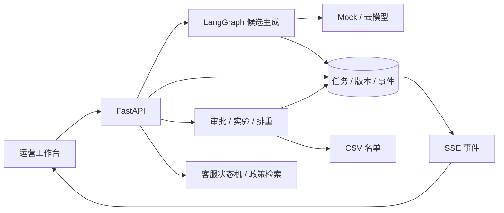

# FlowPilot

**快速体验新版：** [GitHub Codespaces / Windows 一键启动](docs/快速验证.md)。推荐先使用不需要 API Key 的真实后端离线模式，再按说明启用自己的 DeepSeek Key。

面向会员运营和客服的工作流系统。运营人员录入活动目标、客群和预算，系统生成候选方案，人工选定版本后导出试点与剩余人群名单。客服侧提供政策查询和退款审核申请确认。

这是个人开发的演示工程，使用合成客户数据，不连接真实营销渠道、订单或支付系统。

[在线工作台](https://dellya-zhang.github.io/FlowPilot/) · [操作指南](docs/用户操作指南.md) · [架构说明](docs/设计映射与架构.md)

## 业务场景

**会员权益推广。** 运营希望向新会员介绍积分查询和专属客服，不新增优惠。系统生成三套候选，运营审批其中一套后直接导出全量名单。旧版可选单方案试点仍兼容。仓库保存的一次浏览器模拟案例产出 17 人试点、150 人剩余名单，交集为零。

[试点 CSV](web/examples/pilot.csv) · [剩余 CSV](web/examples/full.csv) · [案例记录](web/examples/case.json)


**A/B 试点。** 固定其他条件，仅比较文案、频次或渠道之一。系统冻结两个方案版本，划分互斥客群，记录去重后的模拟反馈，结算后保存描述性结果和推荐，由运营选择胜出方案。全量交付排除两臂所有试点用户。当前不提供统计显著性检验。

**客服。** 合成会员可查询实际 SQL 中的会员画像、订单、物流及政策；指定本人订单并确认后创建本地待审核工单，不调用真实订单或资金系统。政策知识库独立提供 BM25 检索及原文引用。

## 实现

| 模块 | 实现与职责 |
| --- | --- |
| 营销编排 | [planning.py](app/services/planning.py)、[campaigns.py](app/services/campaigns.py)：LangGraph 组织目标、人群、策略、文案与检查节点；有界并发生成候选，SSE 推送事件 |
| 业务状态 | [versions.py](app/services/versions.py)、[entities.py](app/models/entities.py)：SQL 保存任务、候选、修订和审批快照；条件更新限制状态迁移 |
| 名单与实验 | [routes.py](app/api/routes.py)、[experiments.py](app/api/experiments.py)：客群过滤、固定种子抽样、互斥分臂和排重；CSV 与 SHA256 |
| 任务恢复 | [leases.py](app/services/leases.py)：租约、心跳、过期接管及 owner 校验；恢复时重跑生成任务，不是节点级 checkpoint |
| 客服与检索 | [support.py](app/services/support.py)、[knowledge.py](app/services/knowledge.py)：规则路由、确认状态、BM25 及引用；模型不授权业务写操作 |
| 模型费用 | [budget.py](app/services/budget.py)、[limiter.py](app/services/limiter.py)：预算预留与结算、限流、同机跨进程保护 |

新版前端使用 Vue 3 / TypeScript / Vite（保留旧版 HTML/CSS/JavaScript 入口），后端使用 FastAPI、SQLAlchemy、LangGraph。默认 SQLite 和本地文件；可选 PostgreSQL、Redis、MinIO 配置尚未完成组合验证。



## 在线演示与本地运行

GitHub Pages 只运行浏览器模拟适配器，使用模板和浏览器存储，不执行 Python、SQL、LangGraph 或 BM25。完整后端需要本地启动；默认 Mock 模型，不需要 API Key。上面的案例数字来自模拟快照，不是真实营销效果。

## 使用指南

在工作台创建营销计划，生成候选后选择普通审批或 A/B 试点，普通审批直接导出全量；A/B 先记录反馈、结算（提前结算须注明模拟原因）、人工晋级，再下载 CSV。客服入口可输入“退款政策是什么”或“我要退款”，观察咨询与申请的不同处理方式。详细步骤见[操作指南](docs/用户操作指南.md)。

## 快速启动完整后端

需要 Python 3.11+。默认 Mock 模式无需模型密钥，也不需要 Docker、Redis 或 PostgreSQL。

```bash
git clone https://github.com/dellya-zhang/FlowPilot.git
cd FlowPilot
python -m venv .venv
```

Windows PowerShell：

```powershell
.venv\Scripts\python -m pip install -e ".[dev]"
Copy-Item .env.example .env
.venv\Scripts\python -m uvicorn app.main:app --host 127.0.0.1 --port 8000
```

macOS / Linux：

```bash
.venv/bin/python -m pip install -e '.[dev]'
cp .env.example .env
.venv/bin/python -m uvicorn app.main:app --host 127.0.0.1 --port 8000
```

- 工作台：<http://127.0.0.1:8000/>
- Swagger / OpenAPI：<http://127.0.0.1:8000/docs>
- 存活检查：<http://127.0.0.1:8000/api/v1/health>
- 本地静态预览：<http://127.0.0.1:8000/?demo=1>，用于体验浏览器模拟，绕过后端业务请求。

完整模式任务、候选、事件及客服历史保存在 SQL 数据库；文件位于 `artifacts/`。在线静态模式用浏览器存储，两者的数据与实现不同。

### 接入 DeepSeek

仅修改本地 `.env`，不要在网页、README 或 Git 提交中填写真实 Key：

```dotenv
AI_PROVIDER=deepseek
DEEPSEEK_API_KEY=your_local_key
DEEPSEEK_BASE_URL=https://api.deepseek.com
DEEPSEEK_MODEL=deepseek-flash
LLM_MAX_TOKENS=600
LLM_MAX_CALLS=18
LLM_BUDGET_CNY=10
```

重启服务后，新任务会使用真实模型。可选 OpenAI 模式使用 `AI_PROVIDER=openai` 和对应 Key。密钥仅由后端读取，GitHub Pages 不需要任何密钥。

费用机制是保守预算保护：请求前预留，返回 usage 后结算，未返回用量时保留预留；调用与费用名额记录在 `artifacts/llm-usage.jsonl`，跨同机进程使用文件锁。它不是供应商账单系统；删除日志会破坏历史预算连续性。

### 同机多进程与可选基础设施

```bash
uvicorn app.main:app --workers 3
```

各进程必须共享数据库、对象目录及费用日志。SQL 租约和 owner 校验保护任务执行权；心跳续期、过期接管及定期恢复已通过同机独立进程验证。模型并发上限仍按 worker 计算。

```bash
docker compose up --build -d
```

Compose 提供 PostgreSQL、Redis 和 MinIO 配置。该组合尚未在本次环境实测，不将配置存在等同于集成验证。

## API 与测试

本地 Swagger 位于 `/docs`。主要接口：

| 方法 | 路径 | 用途 |
| --- | --- | --- |
| POST | /api/v1/campaigns | 创建任务 |
| POST | /api/v1/campaigns/{id}/generate | 生成候选 |
| GET | /api/v1/campaigns/{id}/stream | SSE 事件 |
| POST | /api/v1/campaigns/{id}/approve | 审批 |
| POST | /api/v1/campaigns/{id}/pilot | 试点导出 |
| POST | /api/v1/campaigns/{id}/full | 全量交付（普通审批或实验晋级） |
| POST | /api/v1/experiments/{id}/finalize | 固化实验结论 |
| POST | /api/v1/experiments | A/B 实验 |
| POST | /api/v1/support/sessions/{id}/messages | 客服消息 |
| POST | /api/v1/support/sessions/{id}/confirm | 确认或取消 |

```bash
python -m pytest -q
python scripts/extreme_http.py
python scripts/multiprocess_check.py
```

历史验证记录：[真实模型联调](docs/DeepSeek联调报告.md)、[HTTP 故障与突发测试](docs/极限工况测试报告.md)、[多进程验证](docs/多进程验证报告.md)。这些报告记录特定环境下的测试，不代表生产容量。付费模型测试不在 CI 自动执行。

## 目录

```text
app/agents/    模型适配与编排
app/api/       REST 接口
app/services/  业务逻辑、规则与基础服务
app/models/    SQL 数据模型
web/           工作台与浏览器模拟适配器
tests/         自动化回归
scripts/       联调、浏览器与多进程检查
docs/          设计及验证记录
```

## 边界

尚未实现生产级账户和租户隔离、真实渠道投放、订单或支付退款、ClickHouse 查询、跨主机全局预算以及图级 checkpoint。详见[设计差异](docs/项目逻辑审计与设计差异.md)与[变更记录](CHANGELOG.md)。

[LICENSE](LICENSE)

[本轮业务流程改造与兼容性说明](docs/业务流程改造.md)

## Agent 运行时

- [营销物化图](app/agents/materialize.py)：冻结快照校验、客群校验、正式交接内容、终态合规、CSV 组装。普通交付和 A/B 两臂使用同一执行图；独立保存试点 CSV 及 SHA256。正式内容使用已审批文案，避免未经审批的模型改写。
- [客服执行图](app/agents/support.py)：意图分流、只读工具、确定性决策、用户确认与落档。可选模型仅选择只读工具及真实检索证据 ID；默认规则模式；不执行外部写操作。[客服 H5](web/support.html) 本地入口为 /support.html。
- [运行时设计与验收](docs/agent-runtime.md)。

活动管理入口 `/#campaigns`，可按目标和状态筛选并进入任务。Chromium 端到端测试：`python -m playwright install chromium && python scripts/browser_runtime.py`（先安装 playwright）。CI 会上传真实浏览器截图供核验。营销预览合规最多重试两次，已审批内容不会静默改写。

### 零售数据与真实工具调用

合成会员有等级、积分、最近消费间隔、累计消费金额和两笔订单；营销可按消费间隔及金额圈选。客服在显式选择合成会员后（`POST /api/v1/support/sessions?member_id=1`），使用真实 SQL 查询；退款必须指明本会员订单并确认，生成本地待审核工单。DeepSeek 模式的查询通过原生 Chat Completions tools / tool_calls 协议调用只读工具，最多三轮；模型错误显式报告，不以模板冒充成功。配置 `AI_PROVIDER=deepseek` 和本机 `DEEPSEEK_API_KEY` 后才会访问模型。合成身份不等于真实身份认证。

## 新版 Vue 运营控制台

本地 Docker：复制 .env.example 为 .env，设置 AI_PROVIDER=deepseek 和 DEEPSEEK_API_KEY（不提交密钥），执行 `docker compose up --build`，访问 <http://127.0.0.1:8000/console/>。不配 Key 可保留 AI_PROVIDER=mock。

Vue 新建的 A/B 试点会在服务端冻结必须先结算的约束。旧 API 调用可在创建时传 `require_finalized: true` 启用同一约束。

客服工作台使用 `POST /api/v1/support/sessions/{id}/messages/stream` 接收 SSE。首帧提供会话 ID，节点完成时发送事件，会话落档后返回最终结果。旧版 JSON 消息接口仍可使用。客服工作台可按需勾选已配置的模型，消费者端使用本地查询流程。

非 Docker：先启动 FastAPI，再在 client/ 执行 npm ci、npm run check、npm run build；访问同一个 /console/。开发模式 npm run dev 对应 http://127.0.0.1:5173/console/，API 代理到本机 8000。本地、Docker 和 CI 均通过 npm ci 使用提交的依赖锁文件。

新版提供活动列表、创建/澄清、候选修订与审批、A/B 试点/反馈/结算/晋级、全量交付、合成会员与客服只读工具、工单和审计。原有复盘批量录入等高级功能仍可在旧版工作台完成。

### 真实模型验收（主动付费）

本地启动 DeepSeek 模式后运行 `python scripts/live_retail.py --confirm-paid`。脚本提交新的营销需求、检查实际模型来源、运行客服原生工具循环并验证供应商响应 ID；不把 Mock 通过当成真实模型成功。默认 CI 不访问收费服务。模型额度由 .env 中 LLM_MAX_CALLS 与 LLM_BUDGET_CNY 控制，日志是保守上界而非实际账单。

真实模型候选包含 `generation_receipt`（供应商响应 ID、模型、本地调用 ID、Token 数和延迟），同步写入候选事件。修订后保留原始生成凭据，但当前文案来源标记为 operator_revision。

### ClickHouse 人群索引

本地 Compose 增加 ClickHouse：启动时将合成会员画像投影到 ReplacingMergeTree，营销圈选通过参数化 HTTP SQL 查询人群 ID，再以 PostgreSQL 的当前同意状态与画像条件二次校验、冻结名单。SQLite 模式不依赖 ClickHouse。已配置的 ClickHouse 故障时返回 503 而非静默换引擎。当前仅启动时刷新静态合成索引，无 CDC 或真实数据同步。新增 Compose 集成 CI 验证 PostgreSQL、Redis 配置、ClickHouse 与 MinIO 的业务交付路径；以实际 CI 结果为准。

**对象存储镜像说明（2026-11）：** 旧 `minio/minio` Docker Hub 镜像已无法拉取；Compose 默认使用固定版本、S3 兼容的 [SILO（MinIO 社区维护分支）](https://github.com/pgsty/silo)，而不是声称仍在运行原版 MinIO。可通过 `S3_IMAGE` 更换兼容镜像；本地已有 MinIO 也可用 `S3_ENDPOINT_URL` 接入。该选择仅用于本地合成业务数据，正式环境需要独立安全和恢复评估。
