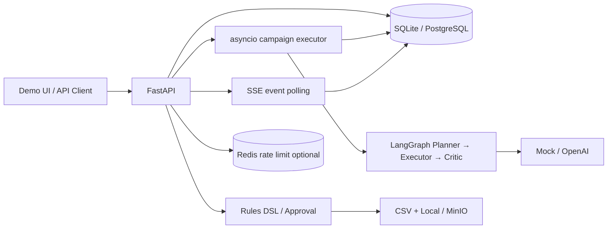

> **最新状态（2026-11-14）**：53项离线测试通过；已完成同机3服务进程共享SQLite的租约续期、强杀接管与跨进程幂等验证，以及8进程共享费用名额竞争。见[多进程报告](docs/多进程验证报告.md)。下方早期“仅单进程”说明为历史局限，当前支持范围以多进程报告为准；不宣称跨主机生产级运行。

# FlowPilot · Backend + Agent 工作台

> Python 后端 + AI Agent 学习型开源工程：**营销方案生成 / 人工审批 / 试点交付 / 全量排重**，以及**智能客服意图路由 / 敏感操作确认**。
>
> **项目性质：**独立演示项目（reference implementation），非企业内部生产代码，不涉及实际用户、真实投放、真实退款或客户数据。可用免费 Mock 模式完成全部本地业务流程。实时模型调用为可选项。

## 主要功能

- **多阶段 Agent 工作流**：LangGraph `StateGraph` 构建 Planner → Executor → Critic，并基于规则执行文案检查。
- **异步候选生成**：`asyncio.as_completed + Semaphore(2)` 并发生成 3 套方案，彼此独立，单候选失败不会中止其余候选。
- **状态机与持久化**：`CREATED → GENERATING → WAITING_APPROVAL → PILOT_READY → PILOT_EXPORTED → COMPLETED`；数据库保存候选、任务状态和事件，启动时重试中断的生成任务。
- **SSE 流式事件**：事件写入数据库、支持 `Last-Event-ID` 续接，轮询推送状态更新（适合演示，非高吞吐事件总线）。
- **可复现名单交付**：模拟 500 个合成客户，固定种子抽样 25 人作为 pilot；导出 CSV，SHA256 校验；finalize 时排除 pilot 已触达客户。重复请求返回同一产物。
- **业务规则护栏**：基于七个显式算子 `eq/ne/gt/gte/lt/lte/in` 的 DSL，不使用不安全 `eval`。
- **客户支持工具路由**：FAQ、订单查询（模拟）、退款审核（人工确认，不执行真实支付操作）。
- **Redis 限流（可选）**：Redis 原子 Lua 脚本固定时间窗口；本地 SQLite 模式自动跳过 Redis。
- **存储双模式**：本地 SQLite + 文件（零基础设施），或 Docker Compose PostgreSQL + Redis + MinIO。
- **A/B 实验**：互斥客群、转化回流去重、描述性转化率、人工晋级、排除两臂用户的全量交付。
- **请求追踪**：X-Request-ID、Server-Timing 与访问日志；可选 ACCESS_TOKEN 共享令牌。
- **测试及 CI**：含 pytest 端到端测试和 GitHub Actions。

## 技术栈

| 层次 | 主要技术 | 用途 |
| --- | --- | --- |
| API | FastAPI、Pydantic | REST 与 OpenAPI 文档 |
| Agent | LangGraph、可选 OpenAI API | Planner-Executor-Critic 图与结构化内容生成 |
| 并发 | asyncio、Semaphore、asyncio tasks | 有界并发、异步任务执行 |
| 数据 | SQLAlchemy 2、SQLite / PostgreSQL | 业务状态、候选、事件、合成客户 |
| 缓存/限流 | Redis（Docker 模式） | 按客户端固定窗口限流 |
| 文件 | 本地文件 / S3 兼容 MinIO | CSV 导出、SHA256 校验 |
| 前端 | 原生 HTML/CSS/JS | 交互式演示（不需要 Node） |
| 交付 | Docker Compose、pytest、GitHub Actions | 本地演示和持续集成 |

## 快速开始

**需要 Python 3.11+，首次安装依赖需要联网。**

```bash
python -m venv .venv
# macOS / Linux:
source .venv/bin/activate
# Windows PowerShell:
# .venv\Scripts\Activate.ps1
pip install -e '.[dev]'
cp .env.example .env     # Windows 可用 copy .env.example .env
uvicorn app.main:app --reload
```

- 前端演示：http://127.0.0.1:8000/
- Swagger 文档：http://127.0.0.1:8000/docs
- 健康检查：http://127.0.0.1:8000/api/v1/health

不设置 `OPENAI_API_KEY` 也能运行完整演示。默认 `AI_PROVIDER=mock`，输出由确定性模板生成，不应被描述为真实大模型推理结果。

### Docker 一键启动（PostgreSQL + Redis + MinIO）

```bash
docker compose up --build -d
docker compose logs -f api
# 访问 http://localhost:8000
```

可选 `.env` 中配置 `AI_PROVIDER=openai` 与 `OPENAI_API_KEY`，Docker Compose 将环境变量传给 API。第三方 API 产生费用，**不要把密钥提交到 GitHub**。

## 一次完整的 API 调用

```bash
# 1. 创建任务，获得 id
curl -s -X POST http://localhost:8000/api/v1/campaigns \
 -H 'Content-Type: application/json' \
 -d '{"brief":"为新用户推出会员欢迎活动，介绍权益和服务内容","audience":"new","budget":10000}'

# 2. 用上一步返回的 id 替换 CAMPAIGN_ID
curl -X POST http://localhost:8000/api/v1/campaigns/CAMPAIGN_ID/generate

# 3. 监听事件：任务完成后查询候选
curl -N http://localhost:8000/api/v1/campaigns/CAMPAIGN_ID/stream
curl http://localhost:8000/api/v1/campaigns/CAMPAIGN_ID/candidates

# 4. 选择一个候选，用返回的 candidate id 替换 CANDIDATE_ID
curl -X POST http://localhost:8000/api/v1/campaigns/CAMPAIGN_ID/approve \
 -H 'Content-Type: application/json' -d '{"candidate_id":"CANDIDATE_ID"}'

# 5. 试点导出 → 全量排重导出
curl -X POST http://localhost:8000/api/v1/campaigns/CAMPAIGN_ID/pilot
curl -X POST http://localhost:8000/api/v1/campaigns/CAMPAIGN_ID/finalize

# 6. 查看可下载的 CSV 产物与哈希
curl http://localhost:8000/api/v1/campaigns/CAMPAIGN_ID/artifacts
curl -OJ http://localhost:8000/api/v1/artifacts/ARTIFACT_ID/download
```

客服：

```bash
curl -X POST http://localhost:8000/api/v1/support/sessions
curl -X POST http://localhost:8000/api/v1/support/sessions/SESSION_ID/messages \
 -H 'Content-Type: application/json' -d '{"content":"我想退款"}'
curl -X POST 'http://localhost:8000/api/v1/support/sessions/SESSION_ID/confirm?approved=true'
```

## 模块结构

```text
app/
  main.py                    # 应用生命周期，数据库初始化、合成数据、恢复
  api/routes.py              # REST / SSE
  agents/marketing.py        # LangGraph 三节点工作流
  agents/provider.py         # Mock / OpenAI Provider
  core/config.py             # 环境配置
  db/base.py                 # SQLAlchemy AsyncSession
  models/entities.py         # 关系模型：Campaign/Candidate/Event/Artifact/Support
  schemas/contracts.py       # 输入输出契约
  services/campaigns.py      # 并发任务、持久化事件、可复现名单导出
  services/support.py        # 客服路由与人工确认
  services/rules.py          # 七算子规则 DSL 与文案审核
  services/storage.py        # 本地文件与 MinIO
  services/limiter.py        # Redis 原子限流
web/index.html               # 原生前端
scripts/                     # 扩展示例脚本
 tests/                      # 集成与单元测试
```



## 运行测试

```bash
python -m pytest -q
```

测试验证生成 / 审批 / pilot / full、重复请求复用产物、pilot 和 full 排重，以及客服敏感操作确认。CI 在可联网的 GitHub Actions 环境中安装完整依赖。

## 已实现与生产化边界

这是一个**可运行的教学/作品集级 MVP**，不是开箱可用于真实企业运营的生产系统：

1. **任务执行仍在 API 进程内**：已实现SQL租约、心跳、owner写入校验与存活worker接管，并通过同机3进程验证；尚无外部队列、跨主机账本或外部调用精确一次语义。生产化仍需outbox、工具幂等键和跨主机协调。
2. **没有账号与租户隔离**：可配置 ACCESS_TOKEN 共享令牌，仅作为单用户部署入口保护。禁止直接暴露公网处理敏感数据。正式部署必须增加 OAuth2/JWT、RBAC、审计日志、CORS 收敛、上传校验和 TLS。
3. **不使用真实营销客户数据**：500 人为合成记录。没有真实营销触达、支付退款、外部工单与 ClickHouse 人群查询连接；这些是后续扩展点，不能当作已实现功能写进简历。
4. **Checkpoint**：业务状态、产物与事件在 SQL 持久化。LangGraph 图本身未配置持久化 checkpointer；因此**不是**节点级精确续跑，而是生成任务重跑。真实业务应为 LangGraph 配置持久化 Checkpointer 并区分副作用节点。
5. **模型质量评估**：Critic 是演示用确定性规则和启发式分数，不是可证明的转化率提升或真实模型评分。Mock 并不调用模型。
6. **MinIO 和 Redis**：Docker 模式使用 MinIO 导出与 Redis 限流；不会假称使用了尚未实现的缓存一致性、分布式锁或消息队列。
7. **数据库建表**：采用 `metadata.create_all` 便于首次演示；真实部署应添加 Alembic 版本化迁移。
8. **固定窗口限流**：可用于功能演示，生产中应进一步按身份/租户限流并处理网关可信客户端 IP。

## 适合面试展开的技术问题

- `asyncio.gather`、`Semaphore`、任务取消、异常传播、后台执行为什么要和 API 生命周期关联？
- Agent 的 `thread_id` 与业务 `campaign_id` 各有什么作用？本项目当前为何只用了业务状态持久化而非 LangGraph Checkpointer？
- PostgreSQL 在多人审批与并发导出时如何通过锁、乐观版本号、唯一约束保障幂等？为何 SQL 条件更新和事务串行化能处理竞争请求？为何不保证跨系统 exactly-once？
- SSE 和 WebSocket 如何选型？`Last-Event-ID` 为什么需要事件持久化？
- 什么是 at-least-once、exactly-once 语义？如何让外部工具调用在重试后不重复执行？
- Redis 限流中的原子性与 TTL 为什么要通过 Lua 脚本实现？

## 发布须知

仓库采用 MIT License；无需任何真实密钥。发布前请根据真实代码和个人完成工作范围撰写项目经历。欢迎将生产化路线放入 GitHub Issues，而不要把尚未开发的能力标为已完成。


## 本次工程补全

- [设计映射及架构](docs/设计映射与架构.md)
- [验收报告](docs/验收报告.md)
- [演示、发布与运维](docs/演示与发布.md)
- [桌面预览](docs/工作台预览.png) / [移动端预览](docs/移动端预览.png)

### A/B 实验 API

生成候选后、审批前：

1. `POST /api/v1/experiments`，请求体 `{"campaign_id":"...","candidate_ids":["A","B"],"per_arm":10}`。
2. 返回两臂互斥用户名单；`POST /api/v1/experiments/{id}/feedback`，请求体 `{"event_id":"唯一事件ID","customer_id":1,"candidate_id":"A"}`（用户必须属于该臂）。
3. `GET /api/v1/experiments/{id}` 查看描述性转化率。
4. `POST /api/v1/experiments/{id}/promote?candidate_id=A` 人工选取胜出方案。
5. `POST /api/v1/campaigns/{campaign_id}/finalize` 导出排除两臂试点用户的剩余名单。

本地实验没有自动观察窗口、统计显著性判断或真实投放归因。人工决定何时晋级。

### 可复现安装

Python 3.12 的本次验收版本见 requirements-lock.txt。跨版本推荐 pyproject.toml 的兼容范围。

```bash
pip install -r requirements-lock.txt
pip install -e . --no-deps
```

本地默认单worker；同机多worker支持范围见多进程报告。可选令牌在 `.env` 设置 `ACCESS_TOKEN`，前端“访问令牌”输入同值。受保护 API 必须带 `Authorization: Bearer ...`；令牌模式前端使用轮询（原生 EventSource 不能附加 Authorization）。未配置令牌时前端使用 SSE。共享令牌不等价于用户认证和数据隔离。

### 并发与事务

生成和审批使用 `UPDATE ... WHERE status = expected` 检查 rowcount，竞争失败返回 409。导出与客服会话在事务开头执行无值变化的 UPDATE 取得数据库写锁/行锁，再读取当前状态；唯一约束作为末端保护。SQLite 会串行化写事务，PostgreSQL 可按行并发。不要在生成任务的模型网络等待中持有导出事务锁。

CSV 对象先落存储、后提交数据库，故崩溃可能遗留孤立文件；不承诺存储与数据库分布式原子事务。启动恢复是整次生成重试，不是 LangGraph 节点精确续跑。


## DeepSeek 真实联调（2026-11-14）

已接入AI_PROVIDER=deepseek，配置见.env.example。15次真实Flash生成、5088Token，API及浏览器工作流通过，离线测试23项通过。

- [真实模型联调及费用](docs/DeepSeek联调报告.md)
- [面试追问与回答](docs/面试追问与回答.md)
- [用量摘要](docs/deepseek-usage-summary.json)

离线测试不调用真实模型。scripts/live_deepseek.py和scripts/browser_deepseek_e2e.py是付费测试入口，不在CI自动执行。检查已有预算审计后再运行。预算日志为artifacts/llm-usage.jsonl，不含凭据或正文。不要删除日志重置本次授权；单worker预算不能用于多副本全局计费。


## 极限工况回归（2026-11-14）

当前离线回归 **50 passed**；新增本机真实HTTP突发、40次SSE断连、实际工作进程强杀恢复，以及故障注入。详细证据及未解决风险：

- [极限工况测试报告](docs/极限工况测试报告.md)
- [机器可读HTTP结果](docs/extreme-http-results.json)
- [极限工况面试补充](docs/极限工况面试补充.md)

新增单进程全局模型并发槽、原子请求准入预留、取消子任务回收、受限退出等待、文件哈希校验、请求/响应大小限制。仍不能多副本运行；预算锁不跨进程，线程/远程调用取消不保证外部副作用停止。

默认MODEL_CONCURRENCY=4、MAX_ACTIVE_CAMPAIGNS=16、CANDIDATE_TIMEOUT_SECONDS=45、SHUTDOWN_GRACE_SECONDS=5。过载返回429，已知依赖故障返回503并提示重试。64KiB请求体上限与10秒读取总时限是当前JSON接口的默认保护。


## 同机多进程

新增数据库租约、心跳、owner写入校验、存活worker自动接管与同机跨进程费用锁。运行 `python scripts/multiprocess_check.py` 可复现，不调用收费模型。部署时需共享数据库、artifact目录和费用日志；MODEL_CONCURRENCY为每worker上限，跨主机需另行设计。

新增配置：LEASE_SECONDS=15、RECOVERY_POLL_SECONDS=2。费用日志使用独立锁文件，预算不会因服务重启重置。共享文件锁仅用于本机/已验证的本地共享卷。
