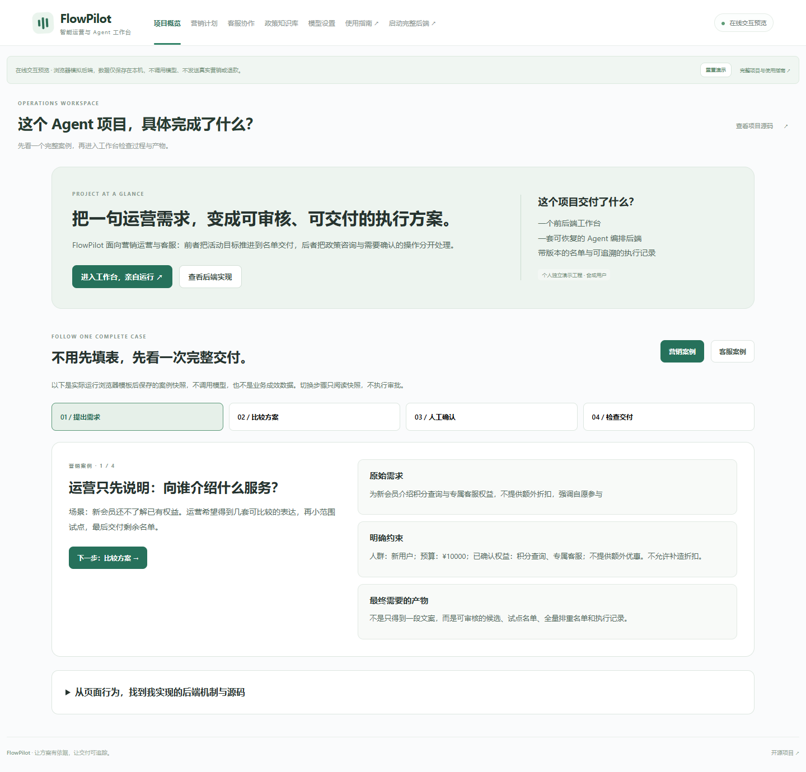
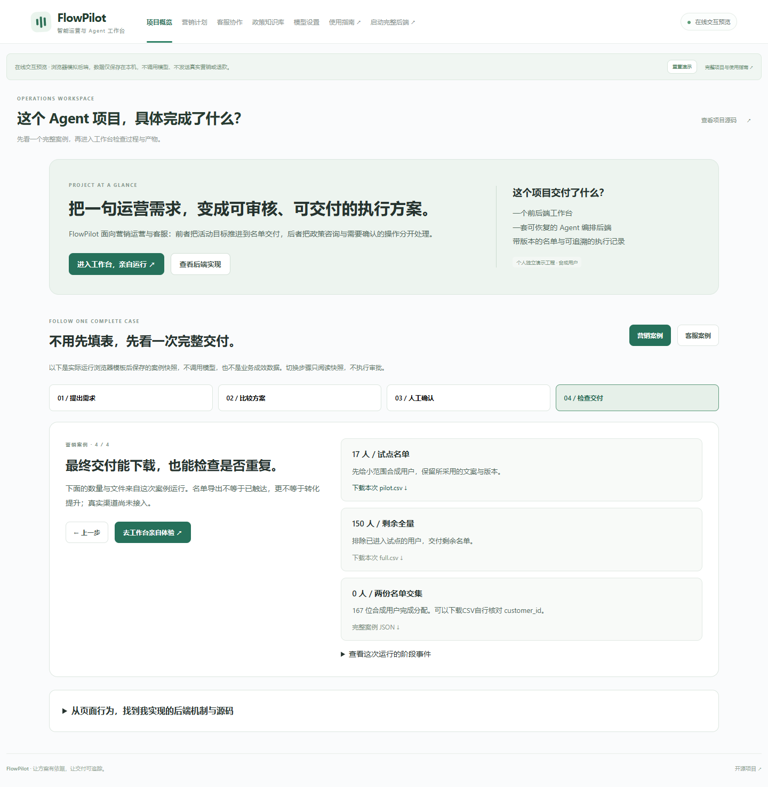
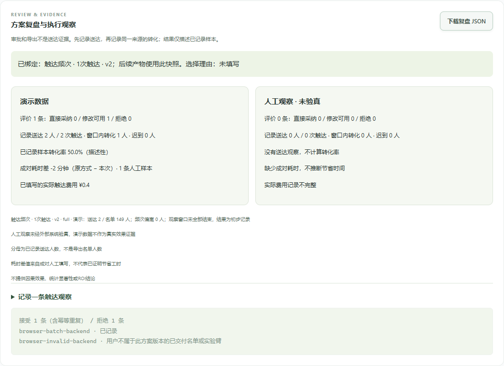
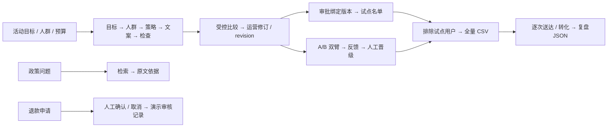
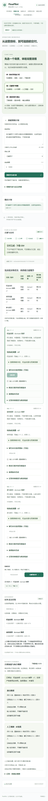
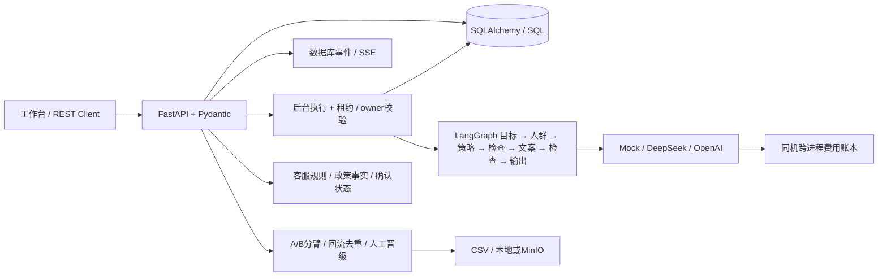

# FlowPilot · 营销与客服 Agent 工作台

[](https://github.com/dellya-zhang/FlowPilot/actions/workflows/ci.yml)
[](https://dellya-zhang.github.io/FlowPilot/)

**让运营从一句活动目标走到可审核的方案与名单交付，让客服从政策咨询走到明确确认的审核记录。**

个人独立演示工程。交付包括前端工作台、FastAPI 后端、Agent 编排与状态恢复机制；使用合成用户，尚未接入真实营销渠道、订单或支付退款。

**[30 秒看懂完整案例 →](https://dellya-zhang.github.io/FlowPilot/)** · [直接运行营销流程](https://dellya-zhang.github.io/FlowPilot/#marketing) · [体验客服确认](https://dellya-zhang.github.io/FlowPilot/#support) · [本地启动](#快速启动完整后端)



## 先看一次具体交付

运营提出：“为新会员介绍积分查询与专属客服权益，不提供额外折扣，强调自愿参与。”

| 过程 | 谁做什么 | 本次案例中的可见产物 |
|---|---|---|
| 输入需求 | 运营确定权益、人群、预算与比较变量 | 新用户、已有权益、不补造优惠 |
| 生成候选 | 系统给出三种表达角度 | 权益说明 / 服务场景 / 自愿参与 |
| 人工决策 | 运营比较并审批一套 | 冻结采用的方案和 v1 版本 |
| 试点交付 | 先导出小范围名单 | **17 人**的试点 CSV |
| 全量交付 | 排除已参加试点的用户 | **150 人**的剩余 CSV，与试点**交集为 0** |

这些数字来自仓库中保存的一次**浏览器模板运行快照**，用于核对流程，不是营销效果、真实触达量或模型能力指标。数据、版本、名单与阶段事件均可检查：

- [试点名单 CSV](web/examples/pilot.csv) · [剩余名单 CSV](web/examples/full.csv) · [完整案例 JSON](web/examples/case.json)
- `python scripts/capture_showcase.py` 可重新录制案例；`python scripts/browser_showcase.py` 校验文件哈希、名单行数与页面行为（需要 Playwright 和 Edge）。



客服案例则展示：**“退款政策是什么” → 只回答政策；“我要退款” → 等待确认；用户确认 → 留下演示审核记录。** 规则客服与本地政策知识库是两个入口，后者提供 BM25 检索与原文引用。

## 核心实现与源码

| 用户看到的行为 | 我实现的关键机制 | 源码 / 验证入口 |
|---|---|---|
| 候选陆续出现，可查看过程 | LangGraph 规划、有界并发、SSE 事件 | [planning.py](app/services/planning.py) · [campaigns.py](app/services/campaigns.py) |
| 人工确认后按版本交付 | 不可变版本、审批快照、状态条件更新与排重 | [versions.py](app/services/versions.py) · [运营版本交付说明](docs/运营闭环与版本交付.md) |
| 后端进程退出后接管任务 | SQL 租约、心跳、owner 校验 | [leases.py](app/services/leases.py) · [多进程验证](docs/多进程验证报告.md) |
| 查询政策有原文依据 | 分块、BM25、可选模型证据筛选、无命中拒答 | [knowledge.py](app/services/knowledge.py) · [知识库说明](docs/政策知识库.md) |
| 咨询与退款申请分开处理 | 规则路由、待确认状态、确认/取消 | [support.py](app/services/support.py) |
| 控制可选云模型调用费用 | 文件锁、预算预留、跨进程限额 | [limiter.py](app/services/limiter.py) · [budget.py](app/services/budget.py) |

**在线与本地的区别：** GitHub Pages 在浏览器模拟后端，数据保存在当前浏览器，不运行 LangGraph、SQL、RAG 或真实模型。完整 Python 后端需要本地启动，默认 Mock，也可配置 DeepSeek 等服务；详见[本地模型接入](docs/本地模型接入.md)。案例页只阅读快照，不自动创建、审批或投放任务。

## 亲自体验

1. 在[项目概览](https://dellya-zhang.github.io/FlowPilot/)逐步查看营销和客服案例。
2. 点“进入工作台”，选择新会员场景，再点击“创建并生成方案”。
3. 比较候选，审批一套，导出试点，再进行全量排重交付；也可另建任务体验 A/B 路线。
4. 下载 CSV 检查版本与人群。客服入口可体验咨询、申请、确认或取消。

## 结构化策略规划

填写业务目标、已确认权益、地区、渠道、单人触达成本和试点参数，候选会保存人群 DSL、策略假设、预算测算、对照组和执行阶段。地区与对照条件实际影响名单；预算不足会在模型调用前拦截。[详细字段、操作和设计差异](docs/结构化营销策略.md)。


## 运营修改、版本交付与效果记录

- **受控比较**：选择只比较文案、频次或渠道；查看输入依据、成本与风险，A/B会拦截非比较变量不一致的方案。
- **运营修订**：保留v1/v2历史与原因，拒绝过期版本修改；审批和实验冻结方案快照，CSV包含实际采用版本。
- **名单快照**：生成时固定人群，后来新增用户不混入，撤回同意者仍排除。
- **复盘记录**：采纳/重写/拒绝、成对耗时、逐次送达和转化；演示与人工观察分组，未完成窗口标为初步结果。
- **批量与导出**：最多100条观察逐条校验，幂等重试；复盘JSON包含绑定快照、来源与原始记录。

[完整操作、指标口径与设计边界](docs/运营闭环与版本交付.md)。当前使用合成用户，未连接真实渠道或业务回执。



## 核心能力

- **目标驱动的方案生成**：按活动目标、权益和人群生成结构化策略；填写单价后执行预算测算，人工决定采用哪一套。
- **两条清晰的决策路线**：单方案试点或互斥 A/B 分臂，选定路线后按阶段推进。
- **可核验的交付**：下载试点与全量 CSV，全量排除试点用户；执行记录保留阶段事件。
- **咨询与操作分离**：政策咨询不产生退款操作；申请必须由用户确认，知识库可返回政策引用。



完整能力对应 Python 后端；GitHub Pages 使用浏览器模板模拟营销与客服流程。详见[本地模型接入](docs/本地模型接入.md)。

## 可以体验什么

| 用户操作 | 页面反馈 | 完整后端中的实现 |
|---|---|---|
| 填写活动目标、人群、预算 | 候选按完成顺序出现 | LangGraph 七阶段规划、asyncio、有界并发、策略快照 |
| 审批某个候选 | 状态推进至可交付试点 | SQL 条件更新、人工确认 |
| 导出试点、全量名单 | 下载 CSV，查看行数；API 提供哈希 | consent 过滤、固定种子抽样、试点排重、SHA256 |
| 创建 A/B 双臂试点 | 展示互斥客群和转化情况 | 事件去重、描述性转化率、人工晋级 |
| 记录模拟转化并晋级 | 胜出方案可全量交付 | 排除两臂所有试点用户 |
| 咨询退款政策、申请退款 | 政策回答或确认/取消按钮 | 确定性路由、事实来源、待确认状态 |
| 查看执行事件和历史任务 | 状态、候选和产物可追踪 | 数据库事件、SSE、Last-Event-ID |

这是独立演示工程，不包含企业内部源码、真实客户数据、真实投放或资金退款。客服操作采用规则路由；独立政策知识库支持 BM25 检索与可选模型证据选择。[知识库说明](docs/政策知识库.md)。

## 使用指南

### 路线 A：单方案交付

1. 在[在线工作台](https://dellya-zhang.github.io/FlowPilot/)输入：`为新会员介绍积分查询与专属客服权益，不提供额外折扣`。
2. 选择人群与预算，点击 **创建并生成方案**，等待三套候选显示。
3. 点击其中一套的 **审批此方案**，确认状态变为“可交付试点”。
4. 点击 **导出试点名单**，再在产物区下载 `pilot` CSV。
5. 点击 **全量排重交付**，下载 `full` CSV。全量名单不包含已参加试点的用户。

### 路线 B：A/B 实验

1. 创建新任务并生成候选，先不要点击普通审批。
2. 在候选卡片选择两个加入A/B对照，点击 **创建双臂试点**。系统检查受控变量、冻结版本并划分互斥用户。
3. 点击 **记录一名模拟转化**。重复点击会去重，不重复增加人数。
4. 查看描述性转化率，再点击某一臂的 **人工选为胜出方案**。
5. 点击 **全量排重交付**。这次会排除两臂试点用户，不只是胜出臂。

转化回流是演示数据；没有显著性检验、自动观察窗口或真实营销效果结论。

### 路线 C：客服确认

1. 输入 `退款政策是什么`，查看政策说明，不产生待执行操作。
2. 输入 `我要退款`，出现确认/取消按钮。
3. 点击 **确认提交审核** 或 **取消申请**。确认只记录演示审核状态，不创建真实工单、不执行支付退款。
4. 输入订单或物流问题，页面会说明当前未连接真实业务系统，不编造订单状态。

在线数据保存在当前浏览器；点击顶部 **重置演示** 可从头体验。桌面与手机均可操作。

<details>
<summary>查看手机界面</summary>



</details>

## 快速启动完整后端

需要 Python 3.11+。默认 Mock 模式无需模型密钥，也不需要 Docker、Redis 或 PostgreSQL。

```bash
git clone https://github.com/dellya-zhang/FlowPilot.git
cd FlowPilot
python -m venv .venv
```

Windows PowerShell：

```powershell
.venv\Scripts\python -m pip install -e ".[dev]"
Copy-Item .env.example .env
.venv\Scripts\python -m uvicorn app.main:app --host 127.0.0.1 --port 8000
```

macOS / Linux：

```bash
.venv/bin/python -m pip install -e '.[dev]'
cp .env.example .env
.venv/bin/python -m uvicorn app.main:app --host 127.0.0.1 --port 8000
```

- 工作台：<http://127.0.0.1:8000/>
- Swagger / OpenAPI：<http://127.0.0.1:8000/docs>
- 存活检查：<http://127.0.0.1:8000/api/v1/health>
- 本地静态预览：<http://127.0.0.1:8000/?demo=1>，用于体验浏览器模拟，绕过后端业务请求。

完整模式任务、候选、事件及客服历史保存在 SQL 数据库；文件位于 `artifacts/`。在线静态模式用浏览器存储，两者的数据与实现不同。

### 接入 DeepSeek

仅修改本地 `.env`，不要在网页、README 或 Git 提交中填写真实 Key：

```dotenv
AI_PROVIDER=deepseek
DEEPSEEK_API_KEY=your_local_key
DEEPSEEK_BASE_URL=https://api.deepseek.com
DEEPSEEK_MODEL=deepseek-flash
LLM_MAX_TOKENS=600
LLM_MAX_CALLS=18
LLM_BUDGET_CNY=10
```

重启服务后，新任务会使用真实模型。可选 OpenAI 模式使用 `AI_PROVIDER=openai` 和对应 Key。密钥仅由后端读取，GitHub Pages 不需要任何密钥。

费用机制是保守预算保护：请求前预留，返回 usage 后结算，未返回用量时保留预留；调用与费用名额记录在 `artifacts/llm-usage.jsonl`，跨同机进程使用文件锁。它不是供应商账单系统；删除日志会破坏历史预算连续性。

### 同机多进程与可选基础设施

```bash
uvicorn app.main:app --workers 3
```

各进程必须共享数据库、对象目录及费用日志。SQL 租约和 owner 校验保护任务执行权；心跳续期、过期接管及定期恢复已通过同机独立进程验证。模型并发上限仍按 worker 计算。

```bash
docker compose up --build -d
```

Compose 提供 PostgreSQL、Redis 和 MinIO 配置。该组合尚未在本次环境实测，不将配置存在等同于集成验证。

## 架构与技术选择



| 层 | 技术 | 职责 |
|---|---|---|
| API | FastAPI、Pydantic | REST、校验、错误响应、OpenAPI |
| 执行 | LangGraph、asyncio | 七阶段工作流、候选并发、超时与取消 |
| 数据 | SQLAlchemy、SQLite / PostgreSQL | 状态机、事务、唯一约束、租约与事件 |
| 交付 | CSV、SHA256、本地文件 / S3 | 产物复用、完整性检查与人群排重 |
| 交互 | HTML / CSS / JavaScript、SSE | 用户操作、候选、事件、历史与下载 |
| 费用 | FileLock、原子文件替换 | 同机跨进程预算预留及结算 |
| 可选 | Redis Lua、MinIO | 固定窗口限流、S3兼容存储 |

业务状态与图状态分离：Campaign 保存跨请求阶段，LangGraph 组织一次生成。当前恢复是整次任务重跑，未配置图级持久化 checkpointer，不声称节点级续跑或外部调用 exactly-once。

## API 速览

完整请求体、响应和可执行示例见本地 `/docs`。

| API | 用途 |
|---|---|
| `POST /api/v1/campaigns` | 创建营销任务 |
| `POST /api/v1/campaigns/{id}/generate` | 触发候选生成 |
| `GET /api/v1/campaigns/{id}/candidates` | 查询候选 |
| `POST /api/v1/campaigns/{id}/approve` | 绑定方案版本审批 |
| `POST /api/v1/campaigns/{id}/candidates/{candidate}/revisions` | 乐观并发修订 |
| `GET /api/v1/campaigns/{id}/evaluation` | 评价、版本及执行观察复盘 |
| `POST /api/v1/campaigns/{id}/observations/batch` | 批量观察及逐条结果 |
| `POST /api/v1/campaigns/{id}/pilot` | 普通试点导出 |
| `POST /api/v1/campaigns/{id}/finalize` | 排重全量交付 |
| `GET /api/v1/campaigns/{id}/stream` | SSE业务事件 |
| `POST /api/v1/experiments` | 创建双臂实验 |
| `POST /api/v1/experiments/{id}/feedback` | 转化回流，事件及用户去重 |
| `POST /api/v1/experiments/{id}/promote` | 人工晋级 |
| `POST /api/v1/support/sessions` | 创建客服会话 |
| `POST /api/v1/support/sessions/{id}/messages` | 咨询或提出申请 |
| `POST /api/v1/support/sessions/{id}/confirm` | 确认或取消待办 |

## 测试与验证

```bash
python -m pytest -q
python scripts/extreme_http.py
python scripts/multiprocess_check.py
```

上述入口使用隔离数据库、Mock 或故障传输，不消耗真实模型费用。浏览器测试另需 `playwright` 与 Edge，静态演示可执行 `python scripts/browser_static_demo.py`。

| 验证 | 结果与范围 |
|---|---|
| 自动回归 | 103项通过，含契约、并发、取消、超时、文件损坏及旧owner拒写 |
| 真实模型 | 15次 DeepSeek 调用、5088 Token；营销接口与浏览器链路通过 |
| 请求突发 | 500次本机HTTP读取全部成功；客户端排队耗时不代表服务端容量 |
| 同机多进程 | 3服务进程续期/强杀接管/幂等通过；8进程竞争2费用名额，严格2接受6拒绝 |
| 静态演示 | 普通HTTP静态服务器上完整操作通过，不访问API或模型服务器 |

[真实模型报告](docs/DeepSeek联调报告.md) · [极限工况报告](docs/极限工况测试报告.md) · [多进程报告](docs/多进程验证报告.md) · [机器可读结果](docs/multiprocess-results.json)

`live_deepseek.py` 和 `browser_deepseek_e2e.py` 是明确的付费测试入口，不在 CI 自动执行。少量样本的字段契约成功率不等于模型业务质量或真实转化提升。

## 实现范围与后续方向

- **已实现**：前后端业务闭环、真实模型适配、SQL状态与事件、人工审批、实验排重、同机租约、费用保护、故障测试与交互预览。
- **尚未实现**：生产账号/租户隔离、跨主机全局预算、真实订单/工单/退款、ClickHouse查询、统计显著性和图级Checkpoint。
- **已知改进点**：已支持权益缺失和模型明确要求补充时的澄清；模型分类及关键词护栏仍可能误判，完整性评分不代表方案质量。
- **部署边界**：同机文件锁依赖共享路径；租约依赖同机时钟；副作用不保证精确一次；`create_all`不替代版本化迁移。

[项目逻辑审计与设计差异](docs/项目逻辑审计与设计差异.md) · [优化路线与验收标准](docs/优化路线.md) · [变更记录](CHANGELOG.md)

## 目录

```text
app/agents/       工作流与模型Provider
app/api/          营销、实验与客服API
app/services/     租约、预算、规则、存储及业务逻辑
app/models/       业务表与执行租约
web/              真实后端工作台及显式浏览器模拟适配器
scripts/          HTTP、多进程、浏览器与可选付费评测
tests/           隔离自动测试
docs/            操作指南、架构、测试结果和截图
.github/workflows/ CI与静态预览发布
```

保留仓库原有 [LICENSE](LICENSE)。欢迎基于实际实现提交问题与改进；请勿提交密钥、真实客户名单或私人资料。
