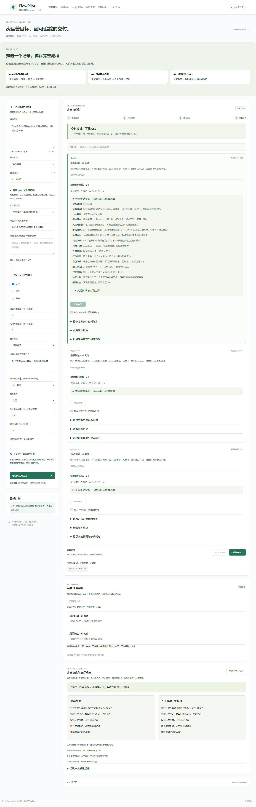

# 结构化营销策略：设计对齐与操作说明

> 后续已补齐受控变量比较、运营版本历史、人群快照与交付绑定，以及逐次观察和复盘。当前完整说明见[运营闭环与版本交付](运营闭环与版本交付.md)。本页保留最初结构化规划字段说明。

日期：2026-11-16。对应本轮结构化策略实现；旧的项目审计保留为改造前基线。

## 从文案候选到策略方案

新计划可填写业务目标、已确认权益、触达渠道、地区、单人触达成本、试点比例、观察天数及是否保留不触达对照组。每个候选返回结构化 plan_data，并保存在 SQL 的 candidate_plans 表中。

LangGraph 路径为：目标理解 → 人群圈选 → 策略规划 → 预算与人群检查 → 示例文案 → 内容规则检查 → 计划输出。目标和策略使用确定性规则，文案由当前 Provider 生成。没有声称每个节点都由模型推理。

| 文档字段 | 本次实现 | 使用方式 |
|---|---|---|
| goal / intent | 目标说明、业务目标枚举、预算、描述性指标 | 运营选择目标；不冒充模型意图识别 |
| segment | 白名单字段上的 AND 条件、数据库规模、可触达与对照人数 | consent / segment / region 条件实际执行七算子 evaluate；不是完整 Segment DSL/TagCatalog |
| user_layers | 可触达人群按现有 segment 分组计数 | 不是复杂生命周期或画像分层 |
| strategy | 三种表达假设、渠道、投放节奏、实验参数 | 三个候选比较权益说明/使用场景/参与指引；不承诺转化提升 |
| offer_strategy | 原样记录运营确认的权益，标注来源 | 不能从“运营填写”推导“事实已外部核验” |
| pilot_schedule | ratio 总和为1的两阶段建议与 window_hours | 供平台交接，不执行短信或其他投放 |
| ab_experiment | 采用的比例/观察天数及规则推荐值 | 观察窗口不自动计时，仍由人工判断晋级 |
| holdout | 开关、比例、人数与实际名单排除 | 完整后端固定种子切分，所有试点和全量都排除对照组 |
| content_preview_variants | 示例文案、finalized=false | 不冒充模板服务已生成投放定稿 |
| compliance | 演示规则 PASS、检查范围 | 不等于法律合规、PII完整检测或事实一致性证明 |
| confidence_signals | 输入完整、费用已知、规模来源等事实信号 | 完整性评分不是概率、策略置信度或转化预测 |
| revision | 当前方案 v1、输入生成后冻结 | 已支持修订历史与审批/交付版本绑定；尚无外部多版本发布系统 |
| event_contract | 回流字段、去重约定 | 仍为人工演示回流，无真实归因系统 |

## 可直接体验的流程

1. 选择首页场景，填写目标和预算；在“策略约束与试点参数”填写已经确认的服务或权益。无优惠时写“不提供额外优惠”。
2. 权益留空时，创建的计划进入 NEEDS_CLARIFICATION，不调用模型。补充后点击“保存补充信息”，再点击“继续生成当前计划”。
3. 预算测算采用运营单价 × 可触达人群。超过预算或人群为空时，生成请求在调用模型前返回422，任务保持可编辑；单价为0表示未知，不显示零成本承诺。
4. 在每张候选卡片展开“查看策略字段、权益依据与预算测算”，比较三种表达假设以及共同的人群、权益和预算约束。
5. 选择单方案审批或 A/B。若开启对照组，它始终不会进入试点和全量名单。单方案按 pilot_ratio 抽样；A/B 将总试点规模按两臂划分，默认每臂 ceil(可触达人数 × pilot_ratio / 2)。
6. A/B晋级后全量排除两臂所有试点用户。模型明确返回 clarification/refusal 时不会变成候选；全部为 clarification 时进入澄清，全部拒绝时任务失败。
7. 生成开始后不能通过 planning API 修改输入，返回409。实验面板通过服务端 experiment_id 恢复，不再依赖标签页缓存。

这仍保留项目已有的“单方案先试点再全量”路线。原始材料普通 confirm 可直接物化全量、pilot_schedule 仅是平台节奏，两者尚未完全统一。页面和接口不声称一比一复刻该物化协议。

## 接口与持久化

- `POST /api/v1/campaigns` 增加可选 planning 对象；不传时兼容旧调用。
- `GET /api/v1/campaigns/{id}/planning` 返回输入、澄清问题、是否可编辑及 experiment_id。
- `PUT /api/v1/campaigns/{id}/planning` 仅在 CREATED/NEEDS_CLARIFICATION 更新参数并决定能否继续。
- 候选接口增加可空 plan_data，包含保存的策略快照；旧候选可能没有该字段的数据。
- PlanningContext/CandidatePlan 使用两个新表，不改变既有表字段，现有数据库通过既有启动初始化创建新表。此方式仅解决本次附加表兼容，不代替未来数据库迁移系统。
- 策略快照保存输入和计算结果，不保存模型完整对话。已保存生成人群快照，后续新增用户不混入，撤回同意者仍排除；未实现完整客户数据变更重放。

请求示例：

```json
{
  "brief": "为新会员介绍积分查询与专属客服",
  "audience": "new",
  "budget": 1000,
  "planning": {
    "intent": "education",
    "known_benefits": "积分查询、专属客服；不提供额外优惠",
    "channel": "in_app",
    "region": "east",
    "unit_cost_cny": 0.2,
    "pilot_ratio": 0.1,
    "window_days": 7,
    "enable_holdout": true,
    "holdout_ratio": 0.1
  }
}
```

地区/用户同意条件和 holdout 会执行；渠道不会执行触达。预算仅估算已提供的触达单价，不覆盖未知权益成本。模型结构字段符合契约也不代表内容事实正确；仍需人工审阅。

## 验证与边界

- 90项 pytest 通过；新增覆盖澄清/零模型调用、预算预检、地区筛选、对照排除、比例抽样、互斥交付、快照冻结、实验恢复、预算传入模型及非草稿拒绝入库。
- `python scripts/browser_planning.py` 分别在普通静态服务器和真实 Python Mock 后端上验证：补充信息、策略展开、A/B恢复、交付、手机布局和预算预检。
- `python scripts/browser_static_demo.py` 继续验证已有路线、CSV下载和无后端/模型网络请求。
- 本轮未调用付费模型，未验证真实模型在新提示词下的业务质量；Provider传参和结构契约使用离线替身验证。
- 未实现：ClickHouse/TagCatalog、模板与权益策略的完整运营 edits、合规定向重试、图级checkpointer、模板服务、真实投放、统计显著性或自动观察归因。
- 公开演示仍是浏览器模拟：筛选和比例生效，但抽样算法与后端不保证逐ID一致，不能用于跨模式名单对账。

后续最值得继续补的是：运营修订与版本快照、可评测的权益/事实校验、原设计 Plan/Pilot/Full 物化协议，而不是先增加更多基础设施。


