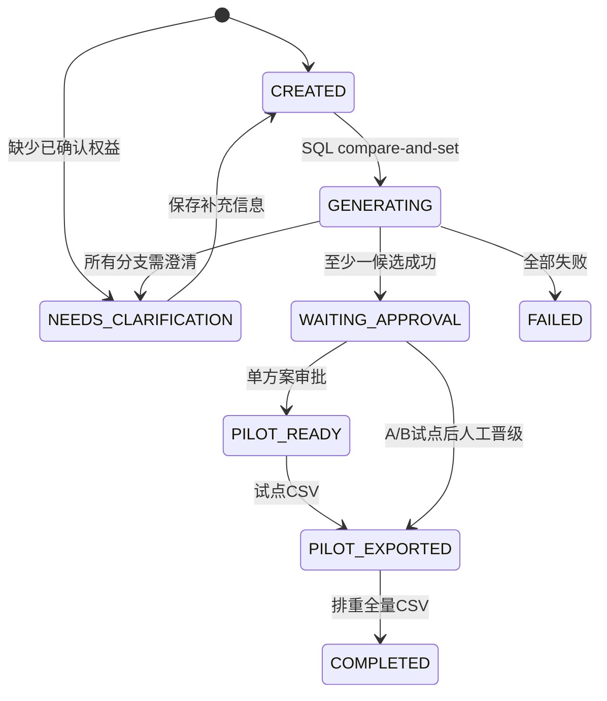

# 设计映射与架构

## 系统定位

面向营销运营的任务工作台，而不是仅做对话；同时提供客服查询与敏感操作确认。独立实现设计材料中的核心业务语义，不复制内部源码，不包含内部网络地址。

## 与设计材料的对应

| 设计要求 | 交付实现 | 边界 |
|---|---|---|
| Plan / Pilot / Full 生命周期 | Campaign 状态机、生成、审批、试点/全量导出 | 状态枚举做了简化 |
| 单次执行子图 | LangGraph 目标理解 → 人群 → 策略 → 规划检查 → 文案 → 内容检查 → 输出 | 未实现文档所有业务节点 |
| 多候选隔离与先完成先返回 | 独立状态字典、Semaphore(2)、as_completed | 无 thread_id checkpointer；不能声称节点级恢复 |
| 人工选择方案 | approve / promote、乐观修订、完整版本历史与选择理由 | 尚非完整模板/权益运营修订协议 |
| 合规不可跳过 | 候选输出入库前检查预算和禁用声明 | 关键词演示规则，非法律合规系统 |
| 可复现试点 | SHA256 种子与固定抽样 | 合成客户，不使用真实个人信息 |
| A/B 闭环 | 互斥分臂、转化事件去重、报告、人工晋级 | 新增逐次观察与首次送达窗口口径；无自动归因、置信区间或显著性判断 |
| 胜出全量排重 | 排除两臂所有已暴露客户 | 只在单次 campaign 内排重 |
| SSE | 持久化事件与 Last-Event-ID | 数据库轮询；无事件总线 |
| 人群查询 | 生成快照、SQLAlchemy Customer、consent撤回过滤 | 不包含真实数据导入或 ClickHouse 适配 |
| 客服简单/复杂/确认分流 | 政策咨询、订单占位工具、退款确认、澄清 | 确定性路由，无 LLM 多轮 tool-use |
| 有来源事实 | facts source/fact 输出 | 客服为固定政策事实；独立知识库为 BM25 摘录与可选模型证据选择，不是向量 RAG |
| 敏感动作 | 明确确认后记录人工审核状态 | 没有真实退款、工单、支付 |
| 行业规则 DSL | 通用七比较算子 evaluate，已用于营销 consent/segment/region AND 筛选 | 不是原文完整画像DSL；未接入客服决策 |

## 状态推进

## 一致性边界

1. 候选唯一键 campaign + variant；恢复前清理未完成候选，再重跑模型。模型调用可能重复并产生费用。
2. 审批 SQL CAS 保证只有一次从预期状态推进。
3. 导出在行锁事务内查已有产物，唯一键 campaign + kind 保障重复调用复用结果。
4. 转化事件主键防止重复回流，实验内用户唯一键防重复计数；不同载荷复用相同 event_id 返回冲突。
5. 已实现 SQL 执行租约、心跳、过期接管和 owner 校验；支持共享数据库、对象目录及预算日志的同机多进程。尚无消息队列/outbox、跨主机集中预算或图级 checkpoint。
6. 错误日志不返回模型供应商敏感响应；候选错误事件只输出异常类型。

## 技术参考

- [SQLAlchemy UPDATE 与 rowcount](https://docs.sqlalchemy.org/en/20/tutorial/data_update.html)：用于条件更新和受影响行数检查。
- [LangGraph compile](https://reference.langchain.com/python/langgraph/graph/state/StateGraph/compile)：checkpointer 和 thread_id 是需要明确配置的能力，本实现没有冒充具备持久化 checkpointer。

最新结构化策略字段与边界见[结构化营销策略](结构化营销策略.md)。

运营闭环的版本绑定、观察口径及本轮验证见[运营闭环与版本交付](运营闭环与版本交付.md)。
