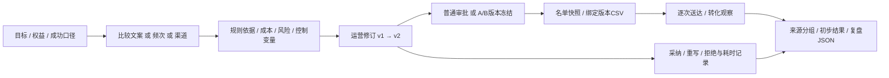
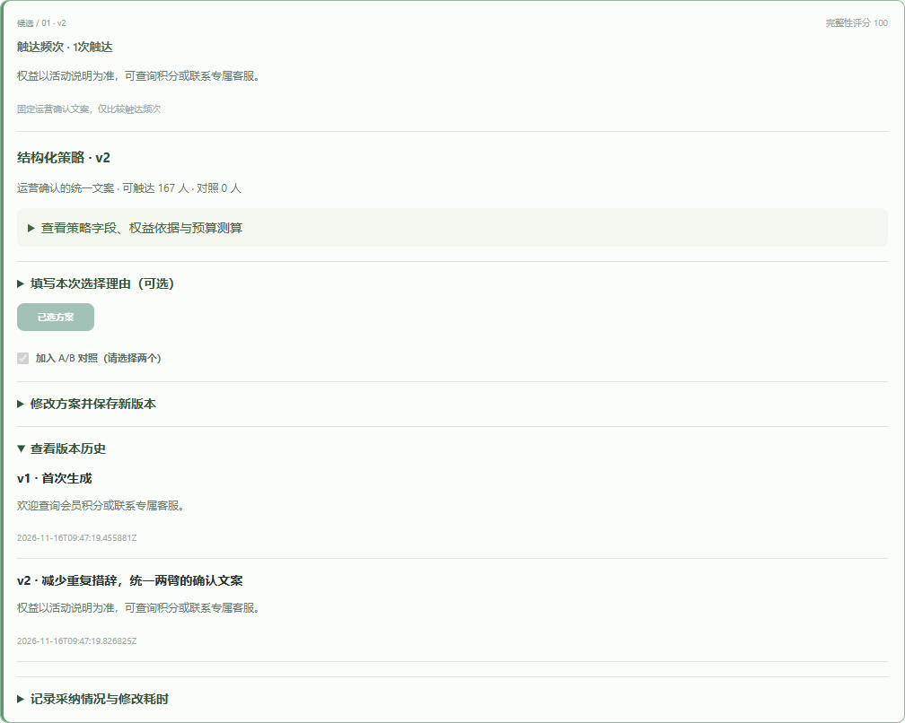
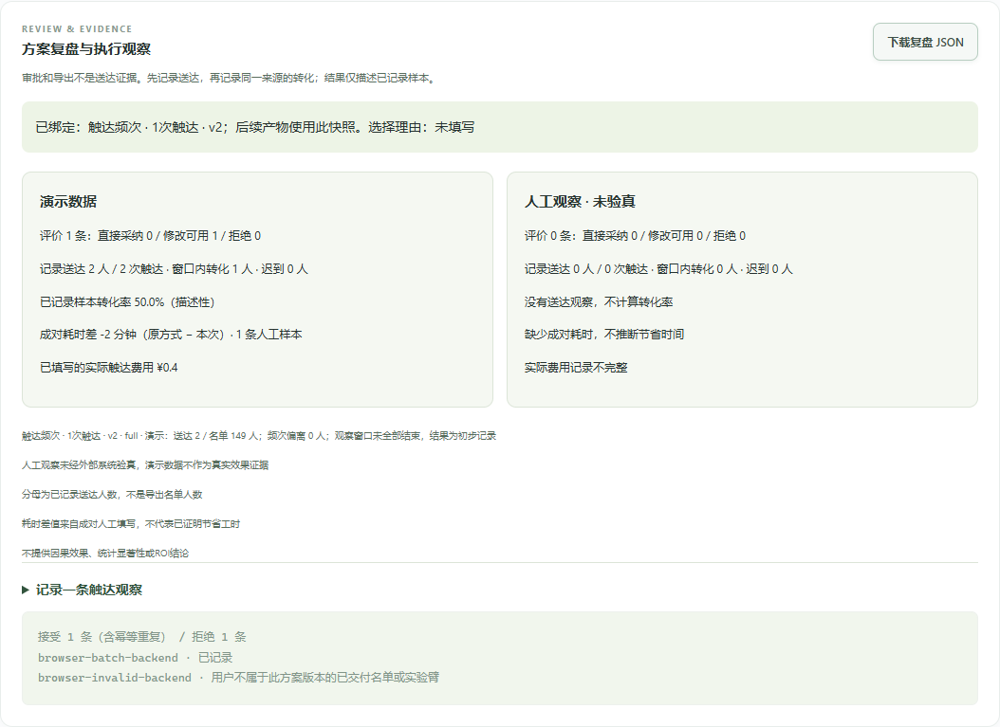

# 运营闭环：受控策略比较、版本交付与效果记录

更新：2026-11-16。此页描述当前实现，替代早期审计中关于“只有文案差异、没有 revision、没有人群版本快照”的结论。

## 产品目标与边界

完整示例是“会员权益触达”：运营明确已有权益、可用渠道和成功定义，比较一个主要变量，修改候选后审批，再交付名单并记录执行观察。它是辅助决策与留痕工具，不是自动投放系统。

现有数据源仍为本地500名合成用户。没有客户导入、真实渠道连接、支付或工单集成。`manual_observation` 代表人工填写的观察，尚未经外部系统验真；它不能自动证明真实业务收益。



## 如何完成一次体验

1. 在营销工作区选择“新会员权益介绍”，输入已确认权益、地区、预算和成功定义，例如“用户主动查询权益或联系专属客服”。
2. 选择“本次只比较”：文案、频次或渠道。频次/渠道实验必须填写一份统一的运营确认文案；渠道实验至少确认两个渠道。
3. 填写每次触达单价。费用估算是 **单价 × 每人计划次数 × 可触达人群**；未知单价不冒充零成本。超预算候选被过滤，全部超预算时在模型调用前拒绝生成。
4. 先看候选对照表，再展开策略中的输入依据、假设、风险、固定变量与建议触达日期。当前没有历史效果数据，因此不自动推荐胜出者。
5. 在候选中展开“修改方案并保存新版本”，修改标题、文案、已确认渠道或次数，并填写原因。原版本保留，支持并发修改冲突检测。
6. 普通审批或选择两个候选加入 A/B 对照。可以填写选择理由。实验建立后版本冻结；修改任何非比较变量可能导致 A/B 创建被拒绝。
7. 交付 CSV。文件包含 customer_id、segment、region、candidate_id、plan_revision、channel、contacts_per_user、message。message 是冻结的已审批示例文案，不是模板服务渲染或渠道验收后的定稿。
8. 在“方案复盘与执行观察”中，先记录指定名单用户的第1次送达，再按顺序记录后续触达。记录转化时，必须已有同一来源的送达记录。
9. 记录方案的直接采纳、修改可用或拒绝原因，以及本次实际处理耗时。只有同时填写可比任务原耗时时才计算差值。
10. 下载复盘 JSON，查看审批快照、选择理由、产物绑定、人工评价、原始观察及按来源/方案/版本/阶段划分的结果。

频次和渠道对比直接使用运营确认的统一文案，不调用模型生成不同文案。文案对比使用当前 Provider。规划仍为规则推导；输入依据、成本与风险均可查看。

## 策略差异与受控比较

| 比较变量 | 候选之间的差异 | 保持不变 |
|---|---|---|
| 文案 | 权益说明、使用场景、参与指引三种表达 | 权益、人群、渠道、频次、成功定义和观察天数 |
| 频次 | 每人1/2/3次及对应日期和成本 | 同一份确认文案、渠道、权益、人群和观察口径 |
| 渠道 | 已确认可用的人工/短信/站内渠道及各自单价 | 同一份确认文案、频次、权益、人群和观察口径 |

渠道单价来自运营输入，不含未知权益、履约或固定成本。渠道可用性也仅是运营声明，当前合成数据没有真实渠道可达字段。参数受控不等于实际执行已经受控；报告会记录次数偏离，不能由方案检查推导因果效果。

规划会给出 hypothesis、decision_basis、controlled_variables、risks、contact_schedule 和 comparison，而不把完整性评分解释为效果预测。

## 版本与名单的一致性

- 每次修订保留完整 snapshot、revision、原因和时间；修改不会覆盖旧快照。
- 修订请求必须携带 expected_revision。两个客户端同时修改同一版本，只能一个成功，其余返回409。
- 页面审批和创建实验携带预期版本；旧客户端不提供版本时按请求处理当时的当前版本绑定，不能获得“拒绝旧页面版本”的保护。
- 普通审批保存 DecisionBinding；A/B保存两个候选的 ExperimentBinding，晋级采用实验建立时的版本，而非读取后来变化的候选。
- 生成时保存 AudienceSnapshot，后续新增用户不混入本次计划。后续撤回同意或已删除的用户仍从可交付名单排除。
- ArtifactBinding保存产物的方案ID、版本、快照哈希、交付时间和名单成员。下载仍验证CSV文件哈希，重复导出复用原产物。
- CSV中单元格以公式前导字符开始时按文本转义；审批快照保留原始文案。
- 标题/文案修订仍只经过演示规则，尚未实现完整权益事实核验或法律合规判断。

这些记录尚无独立用户身份与不可篡改存储，不等同于生产级审计系统。

## 观察与评估口径

**来源隔离**：`demo`与`manual_observation`分开统计；公开浏览器预览只接受demo。完整后端也只针对当前合成名单ID，尚无真实客户数据源接入。

**人数与次数分离**：一位用户第1、2、3次送达是三条记录，送达人数仍为1人。触达序号必须从1开始，不允许跳号；相同序号幂等，不允许覆盖来源或费用。允许记录超出计划的实际触达序号（最多10），用于显示频次偏离，不会执行任何额外触达。

**转化**：同一用户在同一方案版本下只记录一次转化。转化不能早于首次送达；窗口按首次送达时间 + window_days计算，迟到转化单列。送达与转化必须使用相同来源。

**分母**：已记录送达的去重人数，不是导出名单人数，也不是触达次数。不同来源、候选、版本和阶段另列明细。观察窗口未全部结束时标为初步结果；不自动给出显著性或胜出结论。

**费用**：记录的是每次送达的人工填报实际费用；只要有送达记录未填费用，完整实际费用显示未知。没有营收数据，不计算ROI。

**耗时**：成对差值 = 可比任务原耗时 − 本次处理耗时。允许负数，缺少基线时显示未知。样本是人工评价条目，不等同于独立实验或已经证明的工时节省。

**时间**：观察不得明显早于名单交付/实验建立，不能在未来，后续触达不得早于先前记录；保留一分钟时间输入精度容差。

旧“记录一名模拟转化”按钮仍用于实验接口的去重演示，不会混入要求送达证据的观察报告。人工晋级不强制等待窗口结束，可以记录提前选择的原因；不冒充自动实验判决。

## 批量记录

`POST /api/v1/campaigns/{id}/observations/batch`每次接收1–100条结构化记录。

- 请求结构/类型不合法时整批返回422。
- 请求结构有效后逐条检查业务约束；有效记录提交，失败行不写入，并分别返回event_id、status和detail。
- accepted包含合法幂等重复项；duplicate=true代表没有新增数据。有效行重试不会重复统计。
- 页面可粘贴当前名单的JSON数组，方案、版本、阶段和来源使用上方选择。event_id可填写稳定外部事件ID；未填时页面生成。

单条记录示意（ID和时间应使用当前名单及真实填写口径）：

```json
{
  "event_id": "a-stable-receipt-id",
  "candidate_id": "candidate-id-from-response",
  "revision": 2,
  "customer_id": 1,
  "phase": "pilot",
  "outcome": "delivered",
  "source": "demo",
  "occurred_at": "2026-11-16T08:00:00+08:00",
  "contact_number": 1,
  "actual_cost_cny": 0.2
}
```

转化记录使用outcome=converted，contact_number与actual_cost_cny均为null。该示意不能直接用于新建于示例时间之后的计划。

## 接口

| 接口 | 用途 |
|---|---|
| GET /campaigns/{id}/candidates/{candidate}/revisions | 查看完整版本历史 |
| POST /campaigns/{id}/candidates/{candidate}/revisions | 带expected_revision保存修改 |
| POST /campaigns/{id}/approve | 可带expected_revision与decision_reason绑定审批版本 |
| POST /experiments | 可带expected_revisions；检查两臂受控变量并保存快照 |
| POST /experiments/{id}/promote?candidate_id=... | 请求体可带decision_reason；绑定已冻结的胜出版本 |
| POST /campaigns/{id}/reviews | 幂等保存采纳/重写/拒绝及耗时 |
| POST /campaigns/{id}/observations | 逐次送达或去重转化 |
| POST /campaigns/{id}/observations/batch | 最多100条，返回逐条结果 |
| GET /campaigns/{id}/evaluation | 完整复盘数据，页面可下载JSON |

表中路径均以/api/v1开头。字段及边界以本地/docs和源码契约为准。

## 升级兼容与未完成事项

本轮新增七张附加表，不改变已有表字段：plan_revisions、decision_bindings、experiment_bindings、artifact_bindings、audience_snapshots、operator_reviews、execution_observations。仍通过既有启动初始化创建；这不代替Alembic等版本化迁移系统。

历史候选、实验和产物没有完整绑定时会保留旧记录；旧结构候选不能直接使用新修订入口。历史未绑定产物不能作为新观察的成员依据，建议创建新计划体验完整闭环。

尚未实现：真实客户导入及渠道接入、事实核验评测集、模板定稿、自动触达与频控、对照组的因果归因、统计检验、角色/租户权限、身份审计、跨主机协调和图级checkpoint。记录不可直接覆盖；送达时间/费用填错后的带审计更正流程亦待实现。

## 本轮验证

- 103项pytest回归，新增覆盖版本竞态、旧版本审批、A/B混杂变量、渠道费用、固定文案无模型调用、人群新增/撤权、CSV版本绑定与文本转义、评价来源与耗时、逐次送达去重、迟到转化、观察窗口、批量部分失败与重试。
- Edge分别验证浏览器静态模拟和真实Python Mock后端：比较、修订、历史、人工评价、A/B、绑定CSV、单条/批量观察、复盘JSON及手机布局。
- 同机三服务续期/强杀接管通过；60次生成和审批竞争各仅1次接受，60次导出复用一个产物；8进程竞争2次模型名额，2接受/6拒绝。
- 本机真实HTTP突发/断流/强杀恢复脚本通过。此为有限本地测试，不代表生产容量或业务效果。
- 本轮0次付费模型调用。没有真实投放、客户转化或效率收益的验证结论。




